# Relatório Executivo Automatizado

> **Summary in English.** A Python + Office COM automation that produces, every month, the executive report of a
> road-infrastructure program's coordination group (Group 1) straight from the official sources (deliverables
> tracker, meetings log, timeline workbook, measurement spreadsheet, Power BI export), and then audits the whole
> monthly delivery package of five work groups against the program's delivery procedure (naming rules, 100 MB limit,
> searchable PDFs, digital-signature verification, file index) before it is filed. It also talks to SharePoint
> through Microsoft Graph (app-only, dry-run by default, backup + eTag + SHA-256 on every write, no deletes).
> Built by Emmily Maciel with Claude Code/Codex as coding assistants under her review. Fictitious data: this is a
> sanitized copy of a system in real use.

**Dados fictícios. Versão sanitizada de um sistema em uso real; identificadores do cliente foram substituídos.**

## Problema

Todo mês a Coordenação de um consórcio de infraestrutura rodoviária precisa entregar ao Parceiro:

1. o **Relatório de Produtos Mensal do Grupo 1** (P1.1 Gestão Executiva / P1.2 Relações Institucionais) — um
   documento de ~50 páginas com controle de produtos, dashboard, timeline, medição financeira, reuniões, encerramento,
   assinaturas e anexos, montado a partir de várias planilhas e exports;
2. o **pacote mensal dos grupos G1–G5** pronto para protocolo, seguindo um POP com regras rígidas de nomenclatura,
   estrutura de pastas, tamanho máximo, PDF pesquisável, assinatura e Índice de Arquivos.

Feito à mão, isso significava copiar/colar entre Excel, PowerPoint e Word, conferir centenas de nomes de arquivo e
descobrir erros só depois do envio. Regra do contrato: **nunca inventar** dado (entrega, valor, marco, reunião).

## Solução

- **Geração do G1 (Skill `relatorio-prog-grupo1`)**: 20 scripts determinísticos (`01…20`) que leem as fontes
  oficiais do mês, geram prints/imagens com Office COM, montam o Word, aplicam cabeçalho/rodapé/paisagem, exportam
  PDF e passam por **QA automático** (`13_qa`) e **revisão final** (`18_revisao_final`). A redação dos textos é feita
  pela IA a partir das fontes, com regras de redação documentadas.
- **Pipeline da Coordenação (`scripts/entrega.py` + `scripts/prog_entrega/`)**: inventário → validação → staging →
  pacote final no layout do POP → revalidação → manifesto SHA-256 → relatório de prontidão → publicação só com código
  de confirmação. Veredito: `READY FOR PARCEIRO` só com 0 BLOCKER e 0 MANUAL_REVIEW.
- **SharePoint pela Microsoft Graph (`scripts/sharepoint.py` + `scripts/prog_sharepoint/`)**: leitura livre;
  escrita só com autorização, dry-run por padrão, backup + eTag + SHA-256, sem exclusão, pastas bloqueadas para escrita.

## Arquitetura

```mermaid
flowchart LR
  subgraph Fontes["Fontes oficiais (SharePoint / pasta sincronizada)"]
    A[Controle de Demandas .xlsx]
    B[Controle de Reuniões .xlsx]
    C[Controle Timeline .xlsx]
    D[Planilha de Medição .xlsx]
    E[Export Power BI .pdf]
  end
  subgraph G1["Skill relatorio-prog-grupo1"]
    S1[01-08 consolidar / prints / imagens<br/>Office COM]
    S2[09-12 montar Word, encerramento,<br/>paisagem, PDF]
    S3[13 QA + 18 revisão final]
  end
  subgraph Coord["Pipeline da Coordenação (prog_entrega)"]
    P1[inventário + validação<br/>PDF/ZIP/Office/assinatura/nomes]
    P2[staging -> FINAL no layout do POP<br/>Índice a partir do Modelo]
    P3[revalidação + manifesto SHA-256<br/>relatório de prontidão]
    P4[publicar --confirmar código]
  end
  G[Microsoft Graph<br/>prog_sharepoint]
  Fontes --> S1 --> S2 --> S3 --> R[Relatório G1 .docx/.pdf]
  R --> P1
  Fontes --> P1 --> P2 --> P3 --> P4
  P4 <--> G
  G <--> Fontes
```



Detalhes: `docs/ARQUITETURA.md` (camadas, módulos, pipeline) e `docs/dominio/` (processo de entrega).

## Números

| Indicador | Valor | Fonte |
|---|---|---|
| Testes automatizados | **103 passed** (pytest, fixtures artificiais) em 16/11/2026 | `docs/STATE.md` |
| Evolução da suíte | 48 testes (v2.0.0, 01/10/2026) → 50 (02/10) → 103 (16/11) | `CHANGELOG.md`, `docs/STATE.md` |
| Linhas do Controle de Demandas consolidadas no mês (RM16) | 217 (100% do declarado) | `docs/STATE.md` |
| Índice de Arquivos gerado (G1–G5, outubro/2026) | 245 linhas | `docs/STATE.md` |
| Decisões de projeto registradas | 70 (DEC-001…DEC-070) | `references/decisoes-e-erros-conhecidos.md` |
| Tempo economizado por mês | [a confirmar pela autora] | — |

Na versão pública foram executados só 2 arquivos de teste isolados (`test_rm16_regras.py`, `test_sharepoint.py`:
39 passed). A suíte completa fica pendente.

## Como rodar (com os dados fictícios)

Requisitos: Windows, Python 3.12, `pip install -r requirements.txt`. A geração do relatório G1 usa Office COM
(Word/Excel/PowerPoint instalados); a validação do pacote e os testes não.

```powershell
# testes (fixtures artificiais; nada acessa rede)
python -m pytest tests -q -p no:cacheprovider

# pipeline da Coordenação sobre uma pasta mensal (dry-run por padrão)
python scripts\entrega.py --help

# cliente SharePoint/Graph — precisa de credencial própria; ver .env.example
python scripts\sharepoint.py --help
```

Dados fictícios incluídos:
- `.claude/skills/relatorio-prog-grupo1/assets/texts_exemplo_julho2026.py` — textos, marcos e valores inventados
  (habilitado com `PROG_USE_EXAMPLE_DATA`, só para dry-run).
- `docs/referencias-oficiais/ficticio/` — Modelo de Índice mínimo fictício (substitui o oficial).
- `config/*.json` — parâmetros; `organizacao_pop.json` e `g2_pop_ajustes.json` reduzidos a exemplos fictícios.
- `config/parametros-exemplo.json` — copie para `parametros.json` e ajuste.

## O que eu decidi × o que a IA gerou

**Decisões da autora** (produto, processo e arquitetura — registradas como DEC no log de decisões e no `CLAUDE.md`):
- Produzir o relatório **sempre do zero, a partir das fontes oficiais**, e proibir fallback com dados de outra
  competência em execução real (DEC-019, DEC-034…037); se faltar fonte, o sistema pergunta.
- Separar **scripts determinísticos** (arquivos, Office, cálculos) de **raciocínio da IA** (redação, análise, QA).
- **QA obrigatório** antes de qualquer entrega: "script terminou" ≠ "validado" (DEC-040, regra permanente 6).
- Segurança no SharePoint: nunca excluir/mover originais; exceções só com autorização explícita, arquivamento com
  SHA-256 e código de confirmação (DEC-045, DEC-047, DEC-070); Graph app-only com segredo fora do repositório (DEC-052).
- Verificação **criptográfica real** das assinaturas digitais, distinguindo gov.br de ICP-Brasil (DEC-046).
- Regras do POP como **configuração** (`config/entrega_pop.json`), não código fixo; hierarquia de fontes
  POP > Checklist > Modelo de Índice > Fluxograma > regras do repositório.
- Preservar insumos externos antes de usar (DEC-059); versão "EM ELABORAÇÃO" explícita (DEC-064);
  Controle de Demandas = tudo o que os grupos declararam (DEC-067, revogando o corte temporal da DEC-061).
- Repositório como memória: `docs/STATE.md`, `docs/HANDOFF.md`, Skills de abertura/fechamento de sessão.

**Gerado com Claude Code / Codex sob revisão da autora:** a implementação dos scripts `01…20`, dos pacotes
`prog_entrega` e `prog_sharepoint`, dos CLIs e da suíte de testes; cada mudança foi validada por testes, QA do
relatório e conferência visual antes de ser aceita (ver `PROVENANCE.md`: assistentes de IA usados como ferramenta,
sem autoria).

## Stack

Python 3.12 · PyMuPDF · python-docx · openpyxl · python-pptx · pandas · Pillow · cryptography (CMS/PAdES) ·
pywin32 (Office COM) · Microsoft Graph (urllib, app-only) · pytest · Claude Code (Skills) · Power BI (export).

## Verificação, sanitização e licença

- **Testes:** `py -3.12 -m pytest tests -q -p no:cacheprovider` → **103 passed** em 19/11/2026.
- **Dados:** fictícios — cópia sanitizada de um sistema em uso real; nenhum dado de cliente ou de terceiro.
- **Sanitização:** o que foi removido, trocado ou inventado nesta cópia está em [`SANITIZACAO.md`](SANITIZACAO.md).
- **Licença:** todos os direitos reservados; leitura permitida para avaliação de portfólio — ver [`LICENSE`](LICENSE) e [`NOTICE`](NOTICE).

## Aviso

*Dados fictícios. Versão sanitizada de um sistema em uso real; identificadores do cliente foram substituídos.*
Documentos oficiais, planilhas, relatórios, registros de sessão e logos do contrato não fazem parte desta versão.
Contato: perfil GitHub [@Emmilymaciell](https://github.com/Emmilymaciell).
